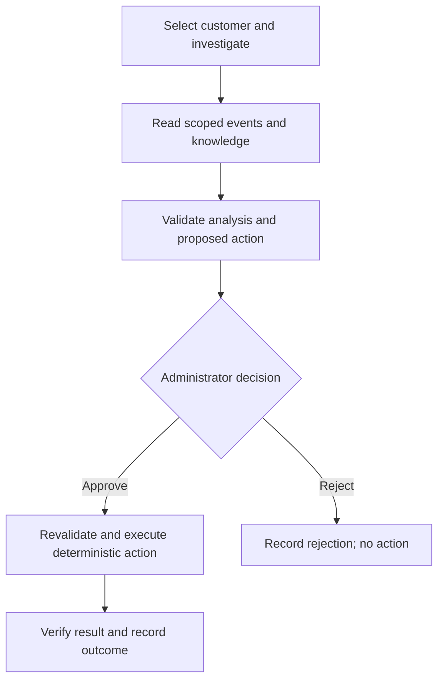

# Martell Automation Suite

A portfolio project for automating customer operations: payment events, CRM updates, membership access, revenue reporting and AI-assisted support. It contains **eight focused modules and a FastAPI dashboard**, using synthetic customer data.

**[Open the hosted demo](https://martell-operations-demo.onrender.com)** · [Setup and API-key configuration](09-dashboard/PLATFORM_SETUP.md) · [Capabilities and limits](09-dashboard/CAPABILITIES.md)

> This is an independent portfolio demonstration, not a Martell Group production system.
> Render hosting and a live Claude investigation have been demonstrated. The observed Claude run produced a retry proposal awaiting approval; its execution and end-to-end external integrations remain unverified.

## Contents

- [Project modules](#what-the-project-contains)
- [System workflow](#how-it-works)
- [Task-by-task walkthrough](#task-by-task-walkthrough)
- [Dashboard tools](#dashboard-tools)
- [Technology implementation](#technologies-and-their-implementation)
- [API and source-code map](#api-and-source-code-map)
- [Configuration](#configuration)
- [Local setup](#run-locally)
- [Demo walkthrough](#demo-walkthrough)
- [Validation and limits](#validation-and-deployment-limits)

## What the project contains

| Module | What it does and how it works |
| --- | --- |
| [01 — Customer lifecycle](01-lifecycle-engine) | Validates payment webhooks, records events and uses deterministic handlers to update customer/CRM/access state. Idempotency prevents duplicate effects; retries and reconciliation support recovery. External clients are tested with fakes. |
| [02 — Revenue reporting](02-revenue-reporting) | Calculates daily metrics from subscription/invoice records, formats executive reports and provides Slack delivery and optional Claude-summary paths. Live delivery is unverified. |
| [03 — Batch classification](03-ai-batch-classifier) | Converts conversations into classification requests, submits/polls Anthropic Message Batches and parses results. Includes an offline baseline and evaluation dataset; a live batch run is unverified. |
| [04 — Coaching and evaluations](04-coaching-evals) | Retrieves relevant sample notes, builds a grounded prompt and checks citations/refusals. Includes an optional Anthropic adapter and evaluation harness; sample content is not official Dan Martell material. |
| [05 — HubSpot operations](05-hubspot-ops) | Analyzes exported properties, workflows and contacts to identify cleanup opportunities and marketing-contact issues. Outputs support review before changes. |
| [06 — Deliverability](06-deliverability-compliance) | Checks DNS email-authentication information and A2P registration inputs. These utilities do not establish successful registration, SMS delivery or healthy email reputation. |
| [07 — Sales copilot](07-sales-copilot) | Mines sample closed-won conversations into patterns; a local API supplies reply suggestions to a Chrome extension. Real CRM selectors remain placeholders. |
| [08 — Team enablement](08-team-leverage) | Ranks recurring requests to find automation opportunities. A playbook and Claude Code commands document repeatable investigation methods. |
| [09 — Operations dashboard](09-dashboard) | Connects browser screens to backend APIs for customers, events, access, revenue, offline AI tools, live investigations, approvals, knowledge search and outcome metrics. |

## How it works

The dashboard serves its HTML/CSS/JavaScript and Python API from one Render service. Browser requests use the same-origin API; secrets stay on the server. Demo lifecycle actions use synthetic data. The separate signed Stripe test inbox records events without changing demo entitlements.

The operations copilot follows this approval workflow:



LangGraph saves workflow checkpoints so an investigation can pause for approval and resume. Claude explains evidence and proposes actions; application code controls changes to access. Failed investigations are visible rather than silently replaced with offline answers.

## Task-by-task walkthrough

| Task | Input → processing → output | Tools and boundary |
| --- | --- | --- |
| Onboard a customer | Checkout event → validate and process payment state → customer record, CRM sync and access decision. | Lifecycle handlers, SQLAlchemy and connector interfaces; demo uses synthetic destinations. |
| Upgrade, renew or offboard | Subscription/invoice event → apply lifecycle rules → updated plan/status or access revocation. | Deterministic Python handlers; production provider ordering still needs verification. |
| Recover a failed delivery | Failed/received event → eligibility check and idempotent retry → processed state or visible failure. | Manual retry or optional backoff worker; the worker is single-process. |
| Investigate missing access | Customer ID and question → scoped event/knowledge reads → validated explanation and proposed action. | Claude, Pydantic and LangGraph; offline mode is also available. |
| Approve or reject | Pending proposal and reason → role/state validation → deterministic execution and verification, or rejection. | Persisted checkpoints, sessions and audit records; an LLM cannot approve its own proposal. |
| Produce revenue reports | Subscription/invoice records → aggregate metrics → report and dashboard charts. | Python reporting module; Slack/Claude paths require separate configuration and validation. |
| Classify conversations in bulk | Conversation records → request IDs and batch submission → polling and parsed predictions. | Anthropic Batch adapter; timeout and missing-result errors are explicit. |
| Answer coaching questions | Question and sample knowledge → retrieve context → answer/citations or refusal. | Coaching module supports an LLM adapter; dashboard coaching is an offline retrieval demonstration. |
| Evaluate behavior | Labelled cases → run classifier/workflow/coaching checks → case-level results and pass counts. | Separate evaluation datasets; deterministic cases do not measure live-model quality. |
| Audit HubSpot data | Exported properties, workflows and contacts → cleanup analysis → recommendations for human review. | HubSpot operations utilities; no claim of complete Enterprise administration. |
| Sync a test CRM contact | Customer state → preview and approval → explicitly enabled test-account write. | HubSpot connector; requires custom properties, account flag and credentials. |
| Review deliverability | Domain/DNS data or registration inputs → authentication/registration checks → findings. | SPF/DKIM/DMARC and A2P utilities; not a sending service. |
| Assist a sales reply | Sample conversation → match closed-won patterns → suggested reply for review. | Python API and Chrome extension; no automatic sending, real CRM selectors unfinished. |
| Improve team self-service | Request log → rank repeated categories/time spent → FAQ, guide or automation opportunity. | Team-leverage module, playbook and Claude Code commands. |
| Search operations knowledge | Text documents → chunk and index → relevant passages for a query. | Lexical default; optional embeddings/pgvector. Copilot lookup remains lexical. |
| Connect another automation client | Authenticated MCP read or n8n webhook → scoped API operation → data or human-review item. | Three read-only MCP tools; n8n template must be imported and configured. |
| Measure operations | Stored runs → aggregate duration/tokens/results → metrics and recovery outcomes. | Local tracing, optional LangSmith; costs and time savings are estimates when configured. |

Developer commands in [`.claude/commands`](.claude/commands) cover `trace-customer`, `triage-failed-events`, `hubspot-cleanup`, `add-stripe-handler` and `explain-simply`. They are instructions for guided developer work, not independently running background services.

## Dashboard tools

| Tool or screen | Implementation |
| --- | --- |
| Customers, events and access | Reads database records, exposes customer timelines and displays event payloads and delivery status. |
| Simulation and retry | Creates synthetic lifecycle events and retries eligible failures through deterministic handlers. |
| Revenue | Computes metrics from sample records and displays charts. |
| Offline AI tools | Conversation classification, coaching retrieval, sales suggestions and coaching evaluations use local logic/sample data without paid model calls. |
| Operations copilot | Calls Claude with bounded tool rounds; validates structured analysis, customer scope and cited evidence before proposing an action. |
| Runs and approvals | Stores run history, tool traces and decisions. Administrators approve/reject with a reason; repeated or stale decisions are guarded. |
| Knowledge | Ingests and chunks text for lexical search; optional embeddings add semantic retrieval. |
| Evaluations | Runs ten deterministic classifier cases and seven isolated copilot cases. These check software behavior, not live-model accuracy. |
| Workflow outcomes | Counts unique recovered events, failures and rejections. Optional manual-time estimates are labelled estimates, not measured production savings. |
| Setup and access | Provides administrator/operator sign-in and configuration-readiness checks; key presence alone does not prove connectivity. |

## Technologies and their implementation

| Technology | Role in this repository |
| --- | --- |
| **Python, FastAPI, Uvicorn** | Business logic, HTTP routes and application serving. The browser calls JSON APIs. |
| **HTML, CSS, JavaScript** | Dashboard layout, charts, forms and API requests. The frontend is plain JavaScript, not TypeScript or React. |
| **Pydantic** | Validates request bodies and structured AI results before application logic uses them. |
| **SQLAlchemy, Alembic** | Database models/queries and schema migrations. |
| **SQLite / PostgreSQL** | SQLite supports the demo; PostgreSQL is configurable for durable data and checkpoints but requires separate provisioning and verification. |
| **LangGraph** | Orchestrates investigation, approval interruption, execution and verification with SQLite/PostgreSQL checkpoint support. |
| **Anthropic Claude** | Live operations investigations; separate modules provide optional coaching/reporting calls and a Message Batches adapter. A live investigation does not verify every adapter. |
| **OpenAI embeddings / pgvector** | Optional semantic document indexing. Embeddings can use JSON storage and Python scoring; pgvector requires database setup. Copilot knowledge lookup currently uses lexical search. |
| **HTTPX** | Makes server-side provider and connector HTTP requests with explicit error handling. |
| **Stripe / HubSpot** | Signed test-webhook inbox and test-account checks; HubSpot sync uses previews and requires approved, explicitly enabled writes. Community access remains a generic adapter. |
| **Slack** | Reporting/notification integration code; dashboard notification actions are previews. Live delivery is unverified. |
| **MCP** | Bearer-authenticated, read-only tools: `get_customer`, `list_failed_events`, `search_operations_knowledge`. No OAuth discovery is implemented. |
| **n8n** | Importable customer-triage workflow calls the authenticated classification API and returns a human-review item. Import, credentials and activation are required. |
| **LangSmith / local tracing** | Local runs record tool calls, duration and tokens; optional LangSmith export sends metadata. Cost estimates require configured rates. |
| **Recovery worker** | Optional single-process retry scheduler with persisted retry state/backoff; not a distributed job queue. |
| **Authentication** | Server-side sessions, role checks, login rate limiting and CSRF/origin protection guard platform actions. Credentials come from environment variables. |
| **Docker / Render** | Docker configuration packages the lifecycle service; `render.yaml` configures the hosted dashboard/API service. |
| **pytest / GitHub Actions / Ruff / uv** | Tests validate behavior; root CI runs pytest and JavaScript syntax checks. Ruff supports linting; uv supports lifecycle-module dependency setup. CI success is separate from local results. |
| **Chrome Manifest V3 / Claude Code** | Extension scaffold connects CRM-page context to suggestions; repository commands and working agreements support repeatable developer workflows. |

## API and source-code map

| API area | Main routes | Implementation |
| --- | --- | --- |
| Offline tools | `POST /api/tools/classify`, `/coach`, `/copilot`, `/evaluate` | [dashboard.py](09-dashboard/dashboard.py); delegates to the focused modules. |
| Authentication | `POST /api/platform/login`, `/logout`; `GET /api/platform/status` | [platform_security.py](09-dashboard/platform_security.py) and [platform_api.py](09-dashboard/platform_api.py). |
| Investigation and decisions | `POST /api/platform/investigate`, `/runs/{run_id}/decision`; `GET /api/platform/runs` | [platform_copilot.py](09-dashboard/platform_copilot.py) implements orchestration; API persists runs/decisions. |
| Knowledge | `GET/POST /api/platform/documents`; `POST /api/platform/search` | [platform_knowledge.py](09-dashboard/platform_knowledge.py), [pgvector.sql](09-dashboard/pgvector.sql). |
| Evaluation and monitoring | `POST /api/platform/evaluate`, `/evaluate-copilot`; `GET /api/platform/metrics`, `/outcomes`, `/audit` | [platform_evaluation.py](09-dashboard/platform_evaluation.py), [platform_outcomes.py](09-dashboard/platform_outcomes.py), API handlers. |
| Sandbox connectors | `POST /api/connectors/stripe/webhook`; `POST /api/platform/hubspot-proposal`, `/slack-preview` | [platform_connectors.py](09-dashboard/platform_connectors.py); webhook validation is in the API module. |
| Automation clients | `POST /api/automation/classify`; `/mcp/` transport | API module plus [n8n workflow](integrations/n8n/customer-triage.json). |
| Storage and recovery | Database models, migrations and scheduled retries | [platform_models.py](09-dashboard/platform_models.py), [migrations](09-dashboard/migrations), [platform_worker.py](09-dashboard/platform_worker.py). |
| Browser interface | HTML, CSS and API calls | [static assets](09-dashboard/static); `app.js` handles the original demo, `platform.js` adds operations screens. |

Routes in the same row share the stated prefix. Platform routes enforce access according to role; MCP and automation endpoints use separate bearer tokens. The browser's API calls do not expose provider keys.

## Configuration

Set secrets in Render Environment or export them locally; local `.env` files are not automatically loaded.

| Feature | Environment variables | Behavior |
| --- | --- | --- |
| Administrator/operator access | `ADMIN_EMAIL`, `ADMIN_PASSWORD`; optional `OPERATOR_EMAIL`, `OPERATOR_PASSWORD` | Passwords must be at least 12 characters. Operators investigate; administrators also approve, ingest and audit. |
| Live Claude | `ANTHROPIC_API_KEY`, `ANTHROPIC_MODEL`, `MAX_LIVE_RUNS_PER_DAY` | Use an enabled model ID; live calls are billed. Daily limit defaults to 20. |
| Durable storage | `DATABASE_URL` | PostgreSQL connection; otherwise SQLite. Provision and verify persistence separately. |
| Semantic search | `OPENAI_API_KEY`, `EMBEDDING_MODEL`, optional `PGVECTOR_ENABLED=1` | Default embedding model is `text-embedding-3-small`; implementation uses 1536 dimensions. Run the supplied SQL before enabling pgvector. |
| MCP / n8n | `MCP_READ_TOKEN`, `AUTOMATION_TOKEN` | Use distinct random tokens; bind n8n credentials before activation. |
| Tracing / cost | `LANGSMITH_TRACING`, `LANGSMITH_API_KEY`, `INPUT_PRICE_PER_MILLION`, `OUTPUT_PRICE_PER_MILLION` | Optional metadata export and configurable estimates; not a billing ledger. |
| Retry scheduling | `RECOVERY_WORKER_ENABLED=1` | Opt-in background retry loop; use one application worker. |
| Outcome estimate | `MANUAL_RECOVERY_MINUTES` | Documented manual baseline multiplied by unique recoveries; not measured time saved. |
| Stripe test connector | `STRIPE_TEST_SECRET_KEY`, `STRIPE_TEST_WEBHOOK_SECRET` | Test-mode read checks and signature verification; webhook inbox does not grant access. |
| HubSpot test connector | `HUBSPOT_TEST_TOKEN`, `HUBSPOT_TEST_ACCOUNT=1`, `ALLOW_EXTERNAL_WRITES=1` | Approved writes require all gates. Create `stripe_customer_id`, `subscription_plan`, `subscription_status` properties first. |
| Slack connector code | `SLACK_TEST_WEBHOOK_URL`, `ALLOW_EXTERNAL_WRITES=1` | Needed for explicitly invoked sending code; dashboard previews do not send. |

Without administrator configuration, legacy synthetic simulation/reset/retry controls remain public; new platform operations still require login. See [platform setup](09-dashboard/PLATFORM_SETUP.md) before hosting your own instance.

## Run locally

Requires Python 3.12+:

```bash
python3 -m venv .venv
source .venv/bin/activate
python -m pip install -r 09-dashboard/requirements.txt
python run_dashboard.py
```

Open **http://127.0.0.1:8000**. Offline features require no model key.

For live investigations, configure `ADMIN_EMAIL`, `ADMIN_PASSWORD`, `ANTHROPIC_API_KEY` and `ANTHROPIC_MODEL` on the server. Use Render's Environment settings for the hosted service; export variables for local runs. Never commit credentials. See [platform setup](09-dashboard/PLATFORM_SETUP.md) for optional connectors and access controls.

## Demo walkthrough

1. Open the dashboard and inspect a customer's timeline, event payload and access status.
2. Use the seeded failed event to show the failure path; explain that all customer data is synthetic.
3. Sign in through **Setup & access**, then investigate the customer in **Operations copilot**.
4. Inspect evidence and the proposed action in **Runs & approvals**. Reject it, or approve with a reason to exercise the demo recovery path.
5. Check the resulting event state, access state and audit trail rather than assuming approval means success.
6. Run classifier/copilot evaluations and inspect case-level results.
7. Review duration, tokens and workflow outcomes; distinguish estimated savings from measured results.
8. Demonstrate knowledge search or a configured connector only when its prerequisites are available.

## Validation and deployment limits

Latest recorded local validation: **132 tests passed**, plus frontend approval/evaluation/outcome smoke checks and Python/JavaScript syntax checks. External-service tests largely use fakes; this is not evidence of production capacity or a live-model accuracy score. Earlier lifecycle lint review found 39 issues; a clean Ruff result is not claimed.

```bash
python -m pip install -r 09-dashboard/requirements-dev.txt
python -m pytest -q
python run_tests.py  # dependency-free module checks
```

Render hosting has been demonstrated, but a GitHub commit does not prove that version is deployed. Ephemeral SQLite data/checkpoints can disappear on redeployment. Production work includes durable PostgreSQL, backups/restores, concurrent processing, distributed workers, monitoring, load testing and verified external integrations.

Not implemented: TypeScript migration, GCP deployment, MySQL, donation/renewal page backends, Zapier/Relay.app workflows, video/event integrations or live Twilio sending. Google ADK, Temporal and Inngest are not installed; LangGraph is the chosen orchestration framework.

## Further reading

- [Platform setup](09-dashboard/PLATFORM_SETUP.md): environment variables, roles, connectors, MCP and n8n.
- [Capability evidence](09-dashboard/CAPABILITIES.md): implemented features and remaining boundaries.
- [Deployment guide](09-dashboard/DEPLOY.md): hosting configuration.
- [Interview guide](docs/INTERVIEW_GUIDE.md): module walkthroughs.
- [Company analysis](docs/COMPANY_ANALYSIS.md): business context.

Not affiliated with, endorsed by, or deployed for Martell Group. All customer records and demonstration coaching materials are synthetic.
